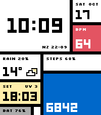
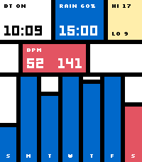

# Mondrian for Pebble Time 2

A De Stijl composition whose planes respond to your day: red for heart rate,
blue for steps, yellow for daylight, and a shrinking grey battery plane.
The tap view recomposes it into a week of steps and heart/weather ranges.

Standalone C watchface, Emery only, 200×228, 64 colours. Version 1.0.1.
The default demo is **pixel-identical** to the original Watchface Lab proposal.
Following Liam's review, the original geometry and compact Silkscreen captions
are the default. Larger labels are an opt-in Clay setting; that setting enlarges
UV/date/NZ and tap-view captions while retaining the original grid.




## Build and install

Requires Pebble SDK 4.33.1 or later and pebble-tool 5.0.40 or later.

```sh
npm install
pebble build
pebble install --emulator emery
# With the phone/dev connection configured:
pebble install --cloudpebble
```

Output: `build/pebble-mondrian.pbw`. Normal builds use live data. A fixed screenshot
build is `LAB_SCENARIO=0 pebble build` (1 stress, 2 empty); rebuild without that
variable before device installation.

## Usage and settings

Tap the screen or flick your wrist to show detail for eight seconds. Tap/flick
again to return immediately. Health updates and time ticks are limited to minute
boundaries. There are no animations or second ticks.

Clay settings: watch/12/24-hour format, Celsius/Fahrenheit, step goal (10,000 by
default), second time zone (NZ, UTC, LON, NYC, LA, TKY, SYD), weather, optional
health demo fallback and larger labels. Settings apply live and persist.
Normal health data is never replaced by demo values unless fallback is enabled.

Weather uses phone location and Open-Meteo. The watch schedules half-hourly
refreshes with a 45-second watchdog and 1/5/15-minute retries. A complete valid
snapshot survives failures and restarts for up to three hours, then all weather
clears together. Forecasts cover the next 24 available hours across midnight;
after sunset the next sunrise is tomorrow's. A cached forecast can have fewer
than 24 hours left, which is represented explicitly.

Battery is grey normally, amber below 40%, red below 10%. `CHG` identifies
charging when the full caption does not fit. A crossed phone tile appears only
when the Pebble phone app is disconnected. Empty health/weather uses dashes.
PebbleOS delays the disconnected notification for 25 seconds to hide brief
reconnections; the marker follows that system behavior.

## Verification

```sh
python3 tests/run.py
python3 tools/render_scenes.py
# Optional external lab location:
WATCHFACE_LAB=/path/to/watchface-lab python3 tools/render_scenes.py
```

The tests require Node, a C compiler and Python's zoneinfo. Rendering additionally
uses Pillow and the existing Watchface Lab host renderer, with no emulator.
There is no lab dependency on the watch or when building a PBW.

Verified on 18 October 2026:

- Clean live PBW build; 19,498-byte RAM footprint and 111,574 bytes free heap
  at the SDK's link-time report, with 10,759 bytes of packaged resources.
- Cross-language weather protocol, malformed data/atomic rejection, cache TTL,
  watchdog/retry state, serialized native phone sends and settings persistence.
- Exact DST boundaries plus 143,192 independent comparisons against Python
  zoneinfo for all seven world-clock presets, sampled every six hours, 2024–2037.
- A live Open-Meteo London response validated and encoded successfully.
- 32 host-rendered scenes: demo/stress/empty, both views, 12-hour/midnight/sunset,
  battery/charging/no-phone/no-health, Fahrenheit, narrow heart ranges, all seven
  weather kinds, tiny step progress and near-goal fill. See `shots/coverage.png`.
- Original demo compared to the lab proposal pixel for pixel, with no difference.
- Final live Emery QEMU installation; wrist-flick detail toggle, eight-second
  return, second-flick return, low/charging battery states and log inspection.
- QEMU battery, charging and disconnected-indicator regions matched the host
  renders pixel for pixel. The forecast survived restart without another injected
  reply. `python3 tools/verify_emulator.py` checks this stored evidence.
- Live Clay settings changed 12/24-hour format, units and caption size, then
  restored the original defaults. The watch accepted a correlated live-weather
  reply, and a restart retained the cached forecast. Injected emulator steps
  appeared on the main face; the injected HR sample appeared in today's range.
- Emulator frame draw timings: 2–11 ms for observed main/detail frames. No bitmap
  cache is warranted by those measurements. Physical-watch timings remain to be
  measured separately.

`tools/emulator_check.py` captures the final smoke test with the normal Pebble CLI.
`tools/emulator_data_check.py`, run with pebble-tool's Python, additionally tests
the Clay response path, live settings, a correlated weather reply and restart
cache using a freshly validated public London forecast. This injected reply
tests the watch transport/cache; it does not establish phone GPS behavior.
QEMU's synthetic health data reported missing minute-history aggregates; the
face handled the unavailable values without an app fault. Physical sensor
history remains a device check.

Glance images exist for both modes and both views. **The original compact
captions remain small by design, following Liam's preference.** The default thus
retains the prototype's caption-readability limitation instead of claiming to
pass the earlier large-label gate. The larger-label option is available for
comparison. All primary clock/health/step numerals retain their original size.

## Physical-watch checks still needed

Verify pale yellow outdoors, actual phone geolocation and live sensor permissions,
and frame timing on a real Time 2. Touch power cannot be measured meaningfully
in QEMU. The default keeps direct tap available; an A/B test build is:

```sh
KIT_TOUCH_WINDOW_MS=10000 pebble build
```

That build enables touch for ten seconds after startup or a wrist flick. Compare
actual battery drain before choosing a different default.

## Kit and release files

The reusable kit is documented at `src/c/kit/KIT.md`, version 1.0. It preserves
the lab contracts and includes watch/phone modules, validated weather caching,
health and Clay settings. Later faces copy this source; they share no runtime.

Store screenshots: `store/emery_face.png`, `store/emery_detail.png`. QEMU evidence:
`shots/emulator-*.png`, `shots/emulator.log`, `shots/emulator-data.log`.
Icons: `icon_80x80.png`, `icon_144x144.png`. Description: `store/description.txt`.
This static face does not need an animated preview GIF.

Source: https://github.com/LiamCordelle/pebble-mondrian

Version 1.0.1 is the initial store release, following approval of the original
composition. Store metadata and the two approved screenshots are in `store/`.

Project: MIT. Bundled font and Clay notices: `THIRD_PARTY_LICENSES.md`.
Original rationale and measured font bearings: `PROTOTYPE_NOTES.md`.
